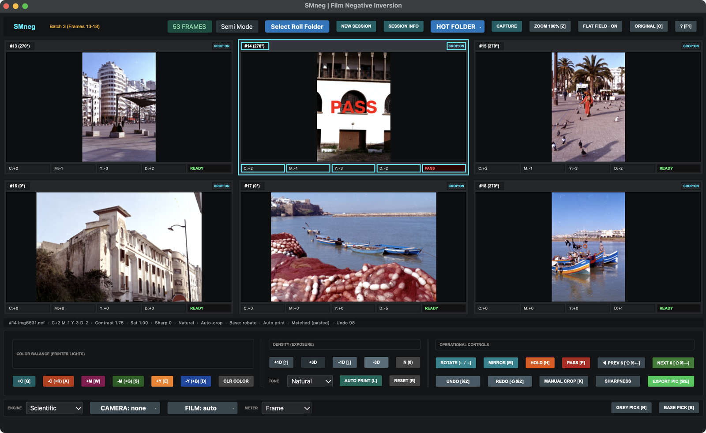
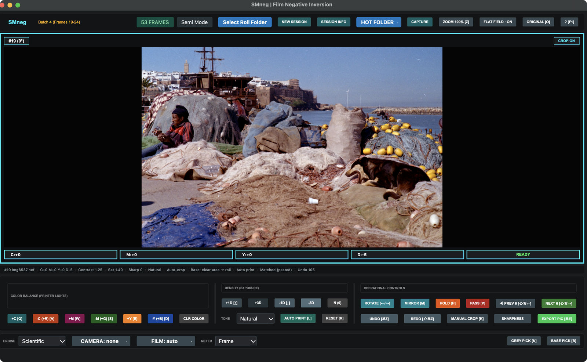
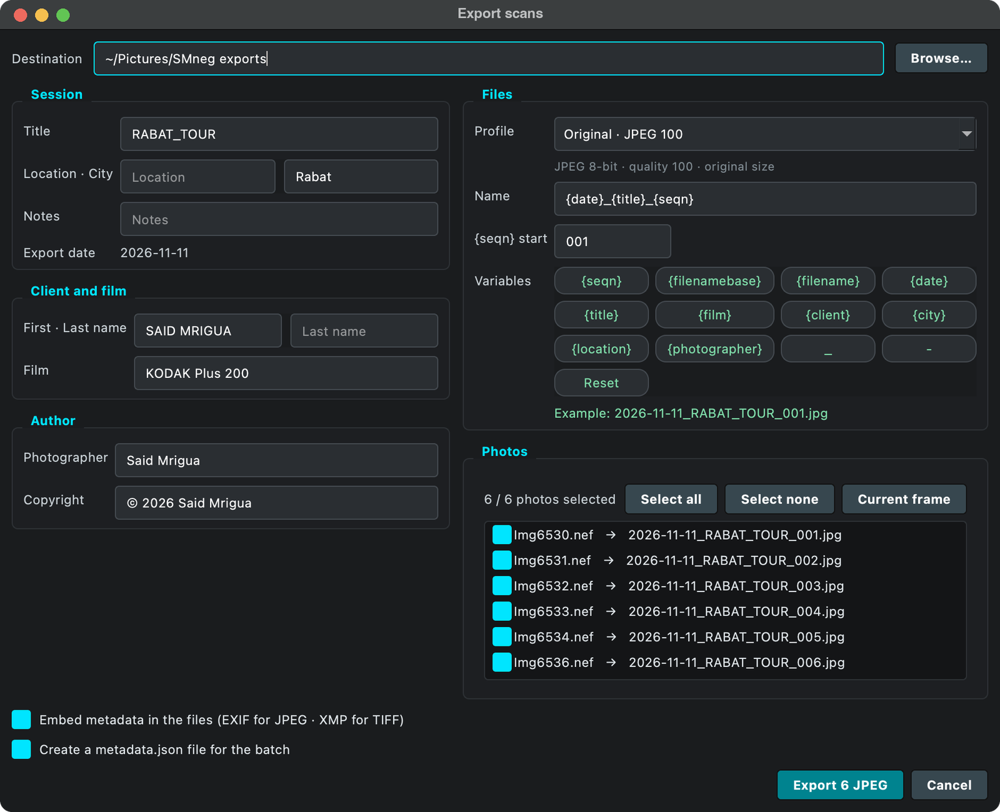
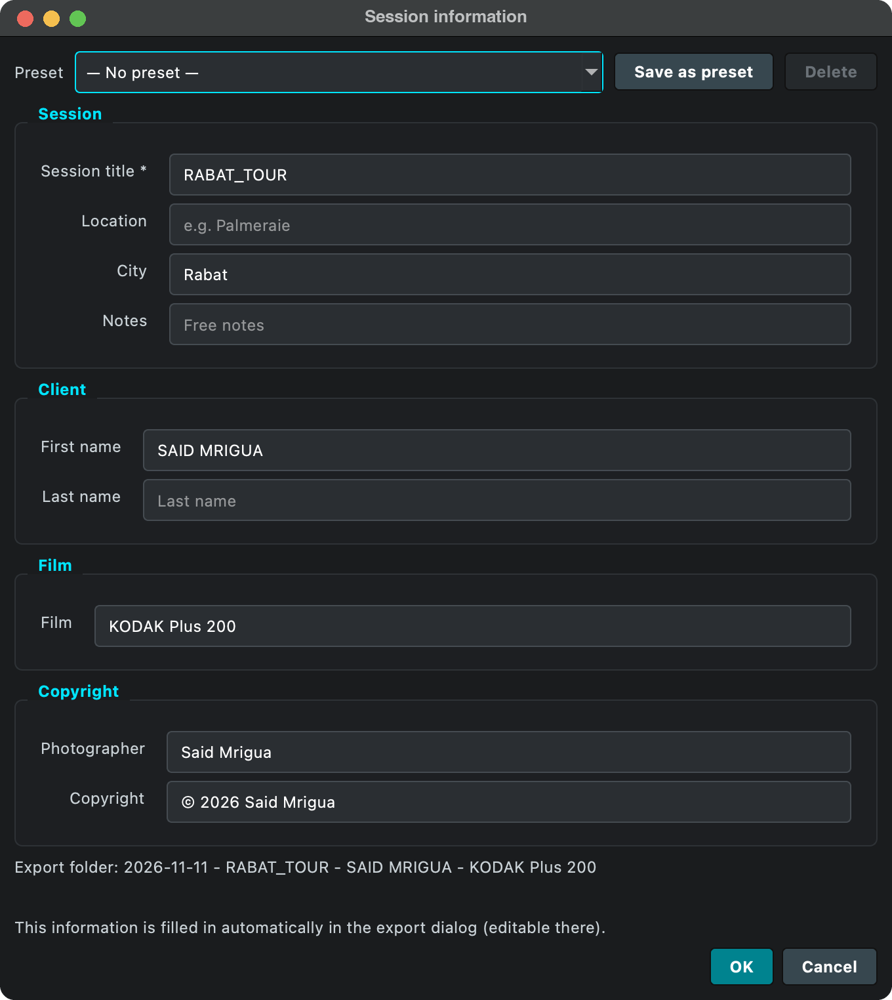
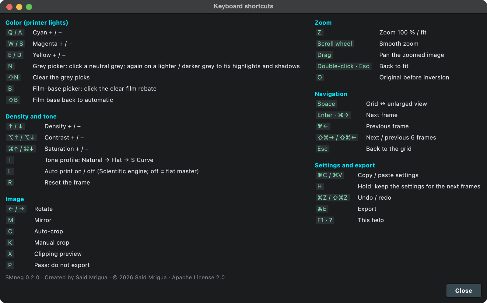

# SMneg

*SMneg = Said Mrigua negative.*

[](https://github.com/saidmrigua/SmNeg/actions/workflows/ci.yml)
[](LICENSE)


Invert camera-scanned film negatives (RAW or TIFF) into positives, adjust them with a printer-lights style
color workflow, and export to JPEG or 16-bit TIFF with an sRGB ICC profile and metadata.


<sub>Left: the negative as photographed (Nikon NEF, linear data). Right: SMneg 0.1.0 result (Classic engine), no manual correction.
Photographs © 2026 Said Mrigua, all rights reserved (the code is Apache-2.0, the photographs are not).</sub>

More examples: [crates](docs/images/crates-before-after.jpg) · [building](docs/images/building-before-after.jpg)

Built for photographers who scan film with a digital camera. The workflow will feel familiar to people
who have used Frontier-style scanning controllers. SMneg is an independent project, not affiliated
with FUJIFILM or Nikon (see [NOTICE](NOTICE)).

## Features
- **Scientific engine** (default, `scientific.py`), see [How it works](docs/how-it-works.md):
  - the **film base** (orange mask) is measured on the rebate, on scans of the roll's clear leader
    (*film base reference*), picked by hand (`B`) or shared by the roll; bare light and the film holder are rejected
  - **density above base**, with the three dye layers balanced over the whole roll, so a grey stays grey
    whatever is in the frame; B&W negatives are detected and rendered neutral
  - **Auto print** (`L`): automatic exposure and contrast per frame, like a lab printer, but one correction for
    the three channels (split grade + paper toe and shoulder); off, a flat 1:1 master
  - **grey picker** (`N`) and **film-base picker** (`B`) in the enlarged view
  - optional **film profile** calibrated from a ColorChecker photographed on the film (density crosstalk, dye
    balance, contrast; [Calibrating a film](docs/calibration.md)) and optional **camera profile** from an IT8
    transparency target
- **Classic engine**: the original 0.1.0 inversion (per-frame auto levels), kept for comparison and for older sessions
- Camera RAW (Nikon, Fujifilm, DNG, Canon, Sony, Olympus/OM, Panasonic, Pentax and the other formats LibRaw reads),
  8/16-bit TIFF, JPEG and PNG (8-bit files are treated as sRGB-encoded)
- CMY / RGB color keys, density, contrast, saturation, tone profiles, sharpness, rotation, mirror, auto and manual crop
- In-place zoom with full-resolution decoding, flat-field (diffuser) correction, clipping preview
- Undo / redo, copy-paste settings, 6-frame navigation, keyboard help on `F1`
- Sessions: enter client / film / copyright information once at *New Session*; it pre-fills the export dialog
- Export to JPEG or 16-bit TIFF with an embedded sRGB ICC profile, Photo Mechanic style filename templates (`{filenamebase}_{seqn}`), embedded XMP/EXIF
  metadata, `metadata.json` sidecar, pipelined for speed
- Hot Folder watching; on macOS, optional capture trigger for Nikon NX Tether

## Screenshots



<sub>Grid view: six frames per page, printer-lights keys, density and tone controls. Frames marked PASS are skipped at export.</sub>

| Enlarged view | Export |
|---|---|
|  |  |

| Session information | Keyboard shortcuts |
|---|---|
|  |  |

## Download
The release workflow is configured to build macOS `.dmg`, Windows `.zip`, wheel and sdist artifacts.
Check [GitHub Releases](https://github.com/saidmrigua/SmNeg/releases) for available downloads. The apps are not code-signed: on macOS right-click the app
and choose *Open* the first time; on Windows choose *More info → Run anyway* in SmartScreen.

## Install from source
Requires Python 3.10 or newer.
```bash
git clone https://github.com/saidmrigua/SmNeg.git smneg && cd smneg
python -m venv .venv && source .venv/bin/activate      # Windows: .venv\Scripts\activate
pip install -e .
```

## Run
```bash
smneg                 # or: python -m smneg   or: python smneg.py
```

## Configuration
Settings (last folders, export options, presets, autocomplete history) are stored with Qt's `QSettings`
under the name *SMneg*; nothing is sent over the network and no API keys are used. Settings saved
by the pre-release version are imported automatically on first launch. Each session stores its data in
`smneg-session.json` inside the session folder (older `frontier-session.json` files still open).

## Platform notes
| | macOS | Windows |
|---|---|---|
| Inversion, zoom, export | yes | expected to work, see limits |
| Nikon NX Tether capture button | yes (needs Accessibility permission) | disabled |

## Color accuracy, honestly
Version 0.1.0 was tested by the community on IT8 targets shot on film and had large grey errors (ΔE 5.8–21.5): its
"film base" step had no effect and density was shown as screen brightness. The full audit is in
[AUDIT_REPORT.md](AUDIT_REPORT.md). The Scientific engine is the answer to it. On the synthetic film model of
`tests/audit/audit_color.py` (Portra- and Ektar-like stocks, D65 and LED light), grey ΔE00 falls from 13–16 (0.1.0)
to 2.2–3.1 after one density setting, and to about 0.9 C* on the greys with a film profile. These are simulation
results: **measurements on real IT8 / ColorChecker targets shot on film are welcome** (open an issue with the scans).

## Known limits
- Automatic neutral balance without a film profile is estimated per roll; a slight cast can remain in the
  extreme highlights or shadows. A grey pick (`N`) or a film profile corrects it.
- A camera profile (IT8 transparency) is exact for slides; for negatives it is an approximation, and a film
  profile (ColorChecker on film) is the more accurate correction. Using both at once is not recommended.
- Export is sRGB only (no Adobe RGB / ProPhoto yet); the preview is not color-managed for wide-gamut displays.
- TIFF input supports 8-bit and 16-bit integer images. Floating-point TIFF is rejected.
- If a source cannot be decoded at full resolution, export skips it and reports the failure; previews are never substituted.
- Developed and used on macOS. Windows support has not been tested on real hardware yet; CI runs the
  non-GUI tests on both systems.
- Full-resolution (45 MP class) frames need several GB of RAM (zoom caches the last full frame).
- RAW demosaicing speed is bounded by LibRaw. The inversion itself is parallelized.
- Version bounds in `pyproject.toml` are conservative; 0.2.0 was tested with Python 3.13, PySide6 6.8, NumPy 2.3,
  Pillow 12.3, rawpy 0.26 (LibRaw 0.22), OpenCV 4.10 and tifffile 2026.3 on macOS (Apple silicon).
- `window.py` is large; splitting it is planned.

## Documentation
- [How it works](docs/how-it-works.md): decoding, density inversion, color pipeline, module map
- [Using SMneg: a typical session](docs/workflow.md)
- [Keyboard shortcuts](docs/shortcuts.md)
- [Calibrating a film with a ColorChecker](docs/calibration.md)
- [Audit report](AUDIT_REPORT.md): the 0.1.0 problems and what changed

## Tests
```bash
pip install -e ".[dev]" && pytest
python tests/audit/audit_color.py        # color-accuracy report (Classic vs Scientific, synthetic film)
```
`tests/test_scientific.py` and `tests/test_film_profile.py` measure color accuracy (grey ΔE, neutrality, film base,
B&W, scan-exposure invariance, preview = export); `tests/test_engine_golden.py` keeps the Classic engine unchanged;
the other tests cover the GUI workflow (pickers, Auto print, profiles, HOLD, import), crop, flat-field, filename
templates, sessions, settings migration, TIFF/XMP/ICC and the hot folder.

## License
Code: Apache License 2.0, Copyright 2026 Said Mrigua. See [LICENSE](LICENSE) and [NOTICE](NOTICE).

Photographs in `docs/images/` are © 2026 Said Mrigua, all rights reserved. They are included to illustrate the
software and may not be reused without permission.
