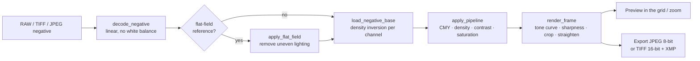

<!-- SPDX-License-Identifier: Apache-2.0 | Copyright 2026 Said Mrigua -->
# How SMneg works

SMneg turns a photograph of a film negative (taken with a digital camera) into a positive, then lets you
fine-tune it the way a printer-lights workflow does: cyan / magenta / yellow and density.

## 1. Decoding
Camera RAW files (Nikon, Fujifilm, DNG, Canon, Sony and the other formats LibRaw reads) are decoded with LibRaw (through `rawpy`) as **linear 16-bit data with no
white balance, no auto brightness and no color conversion**, so the orange mask of a color negative is kept
and the inversion works on real sensor values. JPEG and PNG sources, and 8-bit TIFF, are read with Pillow and treated as
sRGB-encoded (the Scientific engine linearizes them); 16-bit TIFF is decoded as linear data without reducing it to 8 bits. Previews use a
half-size decode (at most 1600 px); full resolution is only decoded for export and for 100 % zoom.

## 2. Flat-field (optional)
A RAW of the bare light source (no film) can be used as reference. SMneg blurs it, normalizes it to its median
and multiplies each scan by the resulting gain map to remove vignetting and uneven backlight. It refuses
references that are over-exposed, too dark, or framed differently from the scan.

## 3. Scientific engine (`scientific.py`, default)

Each step has a physical meaning and is measured, not guessed:

1. **Film base.** The rebate (unexposed film between or around the frames) is found as large uniform
   areas that are the clearest film in the scan. Bare light (no film) and the film holder are rejected
   because they have no orange mask. When no rebate is visible, the clearest area of the image is used,
   and the roll's base is shared with frames that show none. The info bar says which was used.
2. **Density above base**: `D = -log10(scan / base)` per channel. The orange mask is gone exactly,
   independent of the light source and of the scan exposure.
3. **Neutral balance of the roll.** The three dye layers have different contrasts in camera RGB. Their
   ratio is a property of film + light + camera, so it is estimated over the whole roll (pooled density
   distributions, 80–98 % quantiles). A grey stays grey whatever surrounds it.
4. **Exposure.** Densities become relative scene log exposure (`/ 0.6`, the typical C-41 gamma). One
   exposure value per frame is metered (median density) and pulled 70 % towards the frame and 30 %
   towards the roll, so high-key and low-key frames keep some of their character.
5. **Printer lights** C/M/Y and D are offsets in log exposure: 1 point = 0.025 log E (1/12 stop).
6. **Auto print** (on by default, `L` to switch, per frame). The Classic engine's rendering, which keeps
   open shadows and bright mid-tones, made neutral and stable over the roll:
   - each channel's balanced density is normalized between a shadow end and a highlight end (0.5 / 99.5 %
     of the film pixels in the centre of the scan; holder, sprocket holes and bare light excluded), then
     shown through a 1/1.4 power as display value;
   - the ends are split into **brightness** (exposure and contrast) and **colour** (each channel against
     brightness: a slope and an offset). Colour belongs to the film, so it is the roll's: the median of
     its frames, which one strongly coloured picture cannot tint. Classic takes it from each frame alone,
     which is why its colour follows the picture's content. A frame whose film base has another colour
     than the roll's (another film or light in the same folder, tolerance 0.05 log) keeps its own colour,
     and so do rolls of fewer than three frames;
   - **Meter** (`METER` menu, saved with the session) sets where brightness comes from: *Frame* (default:
     each frame fills black to white on its own, like Classic), *Roll lock* (the whole roll: the same tone
     prints the same in every frame) or *Balanced* (half of each). On the synthetic roll, grey chroma is
     0.3–0.8 with any meter, against 1.7–2.7 for Classic (up to 5.7 on its worst frame);
   - with a film profile or on B&W film the three channels share the same ends (the measured balance is
     trusted);
   - colour noise is smoothed (edge-aware, below 1.5 px of a 1600 px preview); brightness and grain are
     untouched. Far beyond white (opaque holder) colour fades to neutral.
   Off, the engine gives the **flat master** described below.
   **Flat master tone.** "Natural" reproduces scene contrast 1:1 (flat, no added contrast) with a soft shoulder
   above 80 % so highlights never clip hard. "Flat" lowers contrast to 0.85, "S Curve" raises it to 1.25.
7. **Camera profile (optional, `CAMERA` button).** A profile measured on an IT8 *transparency* target
   (for example Provia, made with `it8_profiler`) describes the scanning set-up: camera sensor + light
   source. Its matrix (camera RGB → XYZ D50) is converted to camera RGB → linear sRGB and scaled so that
   equal channels stay neutral. It is applied in linear light after the inversion, so greys are kept and
   only hues and saturation are corrected. Above white (film holder, sprocket holes) colour fades to
   neutral first, so the matrix cannot create false colours there. The profile is valid only for the
   camera + light it was measured with, and it does not calibrate the film.
8. **Film profile (optional, `FILM` button).** Calibrated from a ColorChecker 24 photographed on the
   film and scanned on the same set-up (see [calibration.md](calibration.md)). It holds a 3×3 **dye
   crosstalk matrix** applied to density above base (rows sum to 1, so greys stay grey), the **dye-layer
   slopes** measured on the chart's six greys (they replace the roll estimate), and the **film contrast**
   (gamma). The fit minimizes CIEDE2000 to the chart's published values with lightness at half weight.
   It acts at render time; the scan, base and statistics stay raw.
9. **Output** is encoded as sRGB and exports embed an sRGB ICC profile.

RAW files are decoded with `adjust_maximum_thr=0`, so every frame of a roll uses the camera's white
level (LibRaw's default could rescale a single frame; one Z8 scan read 11 % brighter).

**Film base reference** (`FILM` → *Film base reference from scans of clear film*). One to three scans of
clear film (the roll's leader), made with the same camera exposure as the roll, give the base directly:
median of the centre, clipped pixels excluded; SMneg warns if the scans are not uniform or have no orange
mask. It becomes the roll's base and is saved with the session (a new roll starts without it). It matters
most when the rebate is not visible in the frames (tight 35 mm scans): on the synthetic model the grey
error falls from 8–11 to 2.2–2.7 ΔE00. A detected rebate counts only when it runs as a strip along a side
of the frame and its colour matches the roll's base apart from brightness (tolerance 0.15 log); a frame with
its own real rebate keeps it, which protects against a change of scan exposure.

**Pickers** (enlarged view, Scientific engine):
- `N` *grey picker*: click something that should be neutral. SMneg measures the clicked area (about
  0.8 % of the frame) in log exposure and sets the C and Y keys so it becomes grey; M is kept. The result
  is ordinary key values: visible, undoable, copyable.
  A second `N` on a clearly lighter or darker grey (at least 0.15 in density apart) also solves the
  **tilt** of the red and blue layers against green, by least squares over the picks (up to five). This
  removes a cast that grows towards the highlights or the shadows: grey chroma on single synthetic
  frames goes from 5.5 (no pick) to 2.0 (one pick) to 0.1 (two picks). `⇧N` clears the picks.
  An automatic version (finding the greys without a click) was measured and rejected: it helped a
  little on a varied roll and made single frames clearly worse.
- `B` *film-base picker*: click the clear film between frames. That frame uses the picked base, and
  frames of the roll without a visible rebate use it too (the picked base wins over auto-detection).
  SMneg warns if parts of the film are clearer than the clicked point, or if it has no orange mask
  (bare light). `⇧B` returns to automatic detection. The picked base is saved with the session.
- The click is mapped to the scan through the same geometry as the rendering (rotation, mirror,
  crops, straightening), so it works on any orientation, zoomed or not.

B&W negatives (no orange mask) are detected and rendered with one neutral density for all channels.
Previews use a look-up table (within 1/255 of the exact result); exports use the exact math, in
parallel strips of 256 rows. The statistics are taken from the preview and reused at full
resolution, so the export matches what you saw.

## 3b. Classic engine (`engine.py`)
For each color channel independently:

1. **Film base level**: take the 99.5th percentile of the channel in the inner 20-80 % of the frame
   (the edges are ignored because of the holder and light leaks).
2. **Transmittance**: `t = clip(value / base, 1e-4, 1)`. (The per-channel stretch in step 4 cancels
   this base exactly, so the colour balance of Classic comes from the image content.)
3. **Density**: `D = -log10(t)`, the optical density of the negative.
4. **Normalization**: map the 0.5th to 99.5th percentile of `D` (inner region) to 0..1.

The three channels are independent, so frames above 4 MP are computed in 3 parallel threads (the result is
identical to the sequential one within float tolerance; a test checks it). This function is the core of the application and is
protected by `tests/test_engine_golden.py`.

## 4. Color pipeline (`apply_pipeline`)
Applied to the inverted base, in this order:

| Step | Formula |
|---|---|
| Gamma | `x ** (1 / 1.4)` |
| Cyan / magenta / yellow | gain `2 ** (-points * 0.04)` on the red / green / blue channel |
| Density | gain `2 ** (steps * 0.04)` on all channels |
| Contrast | `(x - 0.5) * contrast + 0.5` |
| Saturation | multiply S in HSV |
| Mirror, rotation (90° steps), auto-crop (5 % border) | geometric |

Manual crops and the straighten angle belong to the picture, not to the screen: when rotation or mirror changes, the crop box
is moved with the content (`crop.reorient`), so it keeps framing the same part of the scene.

Then the window adds the tone profile (*Natural*, *Flat*, *S Curve*), sharpness, manual crop and
straightening. Because the pipeline is pure NumPy on the same base array, changing a key re-renders without
re-decoding the file.

## 5. Zoom
The grid shows small previews. In the enlarged view the image is drawn by a custom canvas
(`views.ImageCanvas`). Pressing `Z` (or scrolling) starts a background job that decodes and inverts the
full-resolution frame, then swaps it in without moving the image. The last full-resolution base is cached, so
zooming the same frame again is instant.

## 6. Sessions and settings
`New Session` asks for the shoot information once (title, client, film, location, copyright). It is stored
in `smneg-session.json` inside the session folder together with every frame's settings, and pre-fills the
export dialog. A *Hot Folder* can watch a directory (for example the folder NX Tether writes to) and import
files as soon as they are fully written. Undo / redo keeps a snapshot of the frame before each edit.

## 7. Export
`export.py` builds filenames from a template (`{filenamebase}_{seqn}`, `{date}`, `{city}` ...), writes JPEG
(EXIF) or 16-bit TIFF (XMP, needs `tifffile`) and a `metadata.json`. Loading the next frame, rendering the
current one and writing the previous one happen in parallel.

## Module map

| Module | Role |
|---|---|
| `app.py`, `__main__.py` | Entry point |
| `window.py` | Main window, keyboard handling, sessions, export orchestration |
| `engine.py` | Decoding, Classic inversion and color pipeline |
| `scientific.py` | Scientific engine: film base, roll model, density → print, sRGB |
| `views.py` | Frame cards, enlarged view, zoomable canvas |
| `crop.py`, `zoom.py` | Manual crop dialog, original-image dialog |
| `flat_field.py`, `camera_reference.py` | Flat-field gain, camera-setting comparison |
| `export.py` | Export dialog, filename templates, TIFF/XMP writing, session information dialog |
| `session.py`, `settings.py` | Session files and `QSettings` (with migration from the old name) |
| `hot_folder.py`, `capture.py` | Folder watching, NX Tether trigger (macOS) |
| `help.py` | Shortcut list (F1) |
